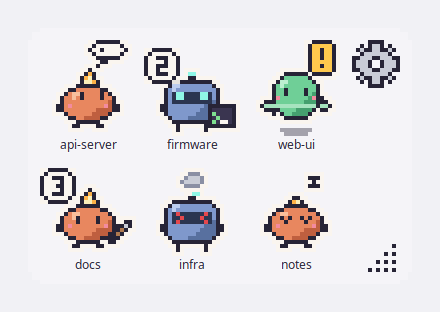
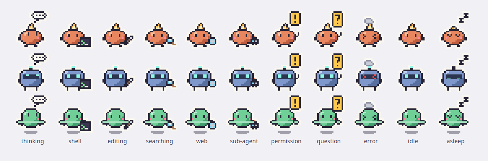

<div align="center">


<picture>
  <source media="(prefers-color-scheme: dark)" srcset="docs/images/deck-dark.gif">
  
</picture>

# agents-deck

**A small pixel-art dock for your coding agents.**
It shows what every Claude Code, Codex and Antigravity session in your Warp
panes is doing right now, including work running in the background.
Click a character to jump to its pane.


</div>

---

**Who this is for:** you work on Linux and run `claude`, `codex` or `agy`
(Antigravity CLI) inside [Warp](https://www.warp.dev) terminal panes, often
several at once. You want to see at a glance which of them is busy, which is
waiting for you, and which has finished, without cycling through tabs.

**Status:** v1. Built and tested on one machine (Ubuntu 24.04, GNOME on
X11). The tablet "stream deck" is only a skeleton so far.

## Contents

- [What the characters tell you](#what-the-characters-tell-you)
- [Requirements](#requirements)
- [Install and run](#install-and-run)
- [Using the deck](#using-the-deck)
- [Where the information comes from](#where-the-information-comes-from)
- [Troubleshooting](#troubleshooting)
- [Tablet stream deck (planned)](#tablet-stream-deck-planned)
- [Development](#development)

## What the characters tell you

Each agent session gets one character. The character tells you which agent
it is:

| Character | Agent |
|---|---|
| **Ember**, an orange blob with a flame tuft | Claude Code |
| **Cubit**, a blue robot with a visor | Codex CLI |
| **Floaty**, a green orb that hovers over a shadow | Antigravity CLI (`agy`) |

What the character is doing tells you what the session is doing:



| You see | It means |
|---|---|
| Thought bubble with dots | The model is generating a reply. |
| Holding a prop | A tool is running. Terminal = shell command, pencil = file edit, magnifier = search, globe = web, little bot = sub-agent, wrench = any other tool. |
| Yellow **!** bubble | It is waiting for you to **approve** something. |
| Yellow **?** bubble | It asked you a **question** and is waiting for the answer. |
| Red eyes and a smoke puff | The last turn ended in an error. |
| Breathing and blinking | Idle: the turn is finished. |
| Eyes closed, **zzz** | Idle for more than 10 minutes. |
| Faded character | agents-deck cannot read this session's state right now. It shows "can't tell" instead of guessing. The tooltip says why. |
| Number in a white pill, top left | That many **background tasks** are still running: background shells, sub-agents, monitors, workflows. Past nine it shows `9+`. |

No number means no background task is running. One exception: Antigravity
does not record its background work anywhere agents-deck can read. For `agy`
sessions the tooltip says "Background work not visible" rather than claiming
there is none.

**Hover over a character** for a tooltip with the agent, what it is doing,
how long it has been idle, and what kinds of background tasks are running.
For programs a Codex session started, it also lists their program names.

## Requirements

- **Linux with an X11 session.** Tested on Ubuntu 24.04 with GNOME (mutter
  46). Wayland is not supported in v1: a Wayland app cannot place itself on
  screen or stay above other windows, and the deck needs both.
- **Warp** terminal, with your agents started inside its panes.
- **Python 3.12** with GTK 3 bindings (PyGObject) and pycairo. A standard
  Ubuntu desktop already has them. If yours does not:

  ```bash
  sudo apt install python3-gi python3-gi-cairo gir1.2-gtk-3.0
  ```

- **make**, to build and install it (`sudo apt install make` if missing).

Nothing is installed with `pip`.

## Install and run

```bash
git clone https://github.com/kimkimsh/agents-deck.git
cd agents-deck
make install
```

Then double-click **agents-deck** on your desktop. You can also press the
Super key, type `agents-deck` and press Enter. To keep it in the dock, open
Show Applications, right-click **agents-deck** and choose **Pin to Dash**.

`make install` needs no root and writes only into your home folder:

| What | Where |
|---|---|
| The program: one file, run by `/usr/bin/python3` | `~/.local/bin/agents-deck` |
| The icon, one PNG per size | `~/.local/share/icons/hicolor/<size>/apps/dev.agentsdeck.AgentsDeck.png` |
| The app-menu entry | `~/.local/share/applications/dev.agentsdeck.AgentsDeck.desktop` |
| The desktop launcher, marked trusted so a double-click runs it | `~/Desktop/agents-deck.desktop` |

The installed program is a copy, so after a `git pull` run `make install`
again. `make uninstall` removes those four files and keeps your settings.
`make` on its own only builds them into `build/`.

You can also run it straight from the source folder, without installing:

```bash
python3 -m agents_deck
```

Starting it again while it runs brings the deck forward; there is never a
second deck.

The deck appears at the bottom centre of your screen. On the first run the
shelf behind the characters stays visible for four seconds so you can see
where the deck is. After that it shows only while your pointer is over the
deck.

If no agent is running yet, the deck shows a single faded character. Its
tooltip says "No agent sessions in Warp" (or "Warp is not running"). Start
`claude`, `codex` or `agy` in a Warp pane and a character appears within
about a second.

To quit, open the settings (gear) and press **Quit agents-deck**, or press
`Ctrl+C` in the terminal you started it from.

## Using the deck

| To | Do this |
|---|---|
| Jump to a session | **Click** its character. Warp switches to that window, tab and pane. |
| See details | **Hover** over a character for about half a second. |
| Move the deck | Hover so the shelf appears, then **drag an empty part of the shelf**. |
| Make it bigger or smaller | **Drag the grip** (the dotted corner, bottom right). Size snaps between 2x and 6x so the pixels stay sharp. |
| Change the order | **Drag a character** onto another slot and release. Press `Esc` while dragging to cancel. |
| Open settings | Click the **gear** on the shelf. |

Everywhere else the deck is see-through to the mouse: clicks on empty space
go to the window underneath. The deck never takes keyboard focus away from
what you are typing in.

**Settings** apply as you change them:

| Setting | Meaning |
|---|---|
| Columns, Rows | Grid size, 1 to 8 each. With more sessions than cells, rows are added; nothing is hidden. |
| Size | Pixel scale, 2x to 6x. |
| Shelf | Show the shelf **on hover** (default) or **always**. |
| Show names | Print each session's folder or session name under its character. |
| Theme | Shelf colours: follow the **system**, or force **light** or **dark**. The characters look the same in both. |
| Reset order | Forget your custom order. |

The order is remembered per Warp pane, so a session keeps its place across
restarts of agents-deck. Settings are stored in
`~/.config/agents-deck/settings.json`.

If your system turns animations off (GNOME's "Reduce animation" setting),
the characters stop animating but still change pose with their state.

## Where the information comes from

agents-deck **only reads files on your machine.** It does not install
hooks, edit any agent's configuration, connect to any agent, or use the
network.

1. **Finding sessions.** About once a second it reads the process list in
   `/proc`. It looks for Warp's `terminal-server` process and, in each
   pane, for a process named `claude`, `codex` or `agy`. Warp sets
   `WARP_TERMINAL_SESSION_UUID` in every pane's environment. That id is how
   a character is matched to its pane and how a click finds it.
2. **Reading the state.**
   - **Claude Code**: its session file `~/.claude/sessions/<pid>.json` and
     the conversation log under `~/.claude/projects/`.
   - **Codex**: the conversation log under `~/.codex/sessions/`. Codex does
     not record which pane shows which conversation, so agents-deck makes a
     best guess from the moment a pane attaches to a conversation
     (`~/.codex/tui-thread-reference-capabilities/`). The tooltip of every
     Codex character says it is a guess. If two Codex panes could be the
     match, the character fades instead of guessing.
   - **Antigravity**: its per-process log in `~/.gemini/antigravity-cli/log/`
     and the conversation's step log.
3. **What it shows.** State, tool names, background task kinds, and the
   session's name (the name you gave a Claude session, otherwise its
   folder name). It never shows or stores your prompts, the agent's
   replies, commands, the descriptions an agent writes for its tasks, file
   contents or account details. Log lines are read one at a time; only ids
   and state values are kept.
4. **What it writes.** Only its own settings file, readable by you alone
   (file mode `0600`).

The formats it reads are not official APIs; they can change when an agent
updates. When a format is not recognised, the character fades rather than
showing a wrong state.

## Troubleshooting

Some fixes below ask you to read agents-deck's messages. It prints them to
the terminal it was started from. If you started it from its icon, quit it
(gear, then **Quit agents-deck**) and run `agents-deck` in a terminal instead.

**Double-clicking the desktop icon opens a text editor, or asks whether to
trust it.**
The launcher was not marked trusted (`make install` uses `gio` for that and
says so when it fails). Right-click the icon and choose **Allow Launching**.

**An agent is running but has no character.**
It has to run inside a Warp pane: started from the pane's shell, or with
`exec` in place of it. Agents inside `tmux` or `screen` are not found,
because their processes belong to the multiplexer, not to the pane. Neither
is an agent started with `exec env -i` (a cleared environment). To see what
agents-deck detects, run:

```bash
python3 -m agents_deck --dump-snapshot
```

This prints one JSON snapshot and exits. Each entry in `sessions` is one
character.

**A Codex character stays faded, with "Can't tell which Codex thread this
pane shows".**
Codex marks the moment a pane opens a conversation: when Codex starts, on
`codex resume`, and on `/new`. agents-deck credits that moment to the one
Codex pane that could have caused it: the one that just started, else the
one in the conversation's folder. If two Codex panes fit equally, it cannot
tell them apart and fades both rather than guess. The same happens for a
Codex pane that was already open before agents-deck started, if its folder
does not settle it. To fix it, type `/new` in that pane (or restart it with
`codex resume`) while no other Codex pane is starting.

**A Codex character shows another pane's work.**
The match is a guess (the tooltip says so). Switching conversations with
`/resume` inside a running Codex can leave no mark that agents-deck can
see. Type `/new` in that pane, or restart it with `codex resume <id>`.

**Clicking a character does nothing.**
The click opens a `warp://session/...` link, which needs Warp registered as
the handler for `warp://`. Check with:

```bash
xdg-mime query default x-scheme-handler/warp
```

It should print Warp's `.desktop` file name. A failed attempt is also
logged as "Warp focus request failed" in the terminal agents-deck was
started from.

**Everything is faded and the tooltip says "Status paused".**
The background reader has stopped answering for more than three seconds.
Look at the terminal you started agents-deck from for an error message.

**The deck is missing, or other windows cover it.**
You are probably in a Wayland session. Log out and pick "GNOME on Xorg" on
the login screen.

**Start over with default settings.**
Quit agents-deck, delete `~/.config/agents-deck/settings.json`, and start
it again.

## Tablet stream deck (planned)

The goal is to plug in a tablet over USB and use it as a touch panel for the
agents. v1 has only the data side: `--dump-snapshot` prints the same
snapshot a tablet would receive. It deliberately carries no free text: no
session names, no tool names, no program names, only states, tool
categories, counts and times. When background work is not visible,
`background` is `{"known": false, "count": null, "kinds": null}` rather
than a count of zero.

```json
{
  "generatedAt": 1795180000.0,
  "warpRunning": true,
  "sessions": [
    {
      "pane": "<32 hex digits>",
      "agent": "claude",
      "phase": "tool",
      "phaseSince": 1795179990.0,
      "waitingFor": null,
      "toolCategory": "shell",
      "background": {"known": true, "count": 2, "kinds": ["agent", "shell"]},
      "confidence": "exact"
    }
  ]
}
```

## Development

```bash
python3 -m unittest discover tests                 # unit tests, synthetic data only
pyright                                            # type check (needs the .venv below)
python3 -m tools.render_readme_images docs/images  # rebuild the images in this README
```

`pyright` reads its type stubs from a local `.venv` (ignored by git). Create
it once; it sees the system GTK bindings and adds only stubs and Pillow:

```bash
python3 -m venv --system-site-packages .venv
.venv/bin/pip install PyGObject-stubs pillow==10.2.0
```

The image script draws demo sessions with the real renderer. It never
captures your screen. It needs Pillow: run it with `.venv/bin/python`, or
install `python3-pil`.

The app icon is drawn from the same sprites by `tools/render_app_icon.py`,
which `make` runs. It needs only pycairo.

- `docs/design.md`: how it works and why it is built this way.
- `docs/work_log/`: the build log, with the evidence behind each decision.
